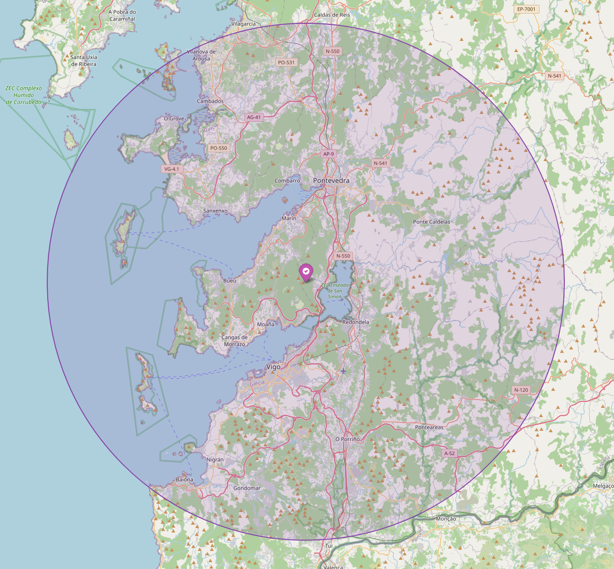
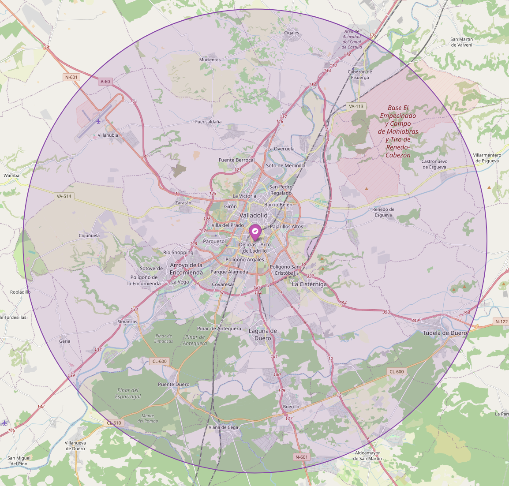

<!-- Profile README for Adrian Bernardo (trotss) -->

<h1 align="center">Adrián Bernardo Barrero</h1>

  <strong>Ingeniero en Telecomunicaciones | Data Science | Machine Learning</strong> 
  <em>Investigación aplicada, ciclo completo de ML y sistemas con LLMs y RAG.</em>

  
  
  

  

---

  
  

---

## Sobre mí

Ingeniero de Telecomunicaciones especializado en ciencia de datos y aprendizaje automático. Ciclo completo ML: preparación de datos, ingeniería de características, modelado, evaluación y reporting, aplicado a series temporales y texto no estructurado. Autodidacta

| | |
|---|---|
| **Formación** | Máster en Ingeniería de Telecomunicaciones (mención Telemática), Universidade de Vigo Grado en Ingeniería de Telecomunicaciones (mención Electrónica), Universidad de Valladolid |
| **Investigación** | AI Researcher & Data Scientist en GTI, AtlanTTic (Universidade de Vigo) |
| **Enfoque** | ML clásico y Deep Learning, series temporales, LLMs, RAG, cloud en AWS |
| **Aprendiendo** | Preparación de la certificación AWS Solutions Architect, automatizaciones con IA, desarrollo web |
| **Intereses** | I+D+I, redes, ciberseguridad, IA, datos, Ciberseguridad |

---

## Áreas de trabajo

- **Machine Learning end to end**: Random Forest, XGBoost, clustering, PCA y Deep Learning, con validación cruzada y Stratified K-Fold.
- **Ingeniería de características**: codificaciones de series temporales (GASF, MTF) y extracción de variables con LLMs a partir de texto no estructurado.
- **Evaluación y reporting**: métricas personalizadas, monitorizar modelos y calidad del dato.
- **LLMs y RAG**: prompt engineering, integración de APIs de LLMs, embeddings y bases de datos vectoriales.
- **Datos y cloud**: procesamiento distribuido con PySpark, SQL y servicios serverless en AWS y Cloudflare.

---

## Stack tecnológico

<h4 align="center">Lenguajes y ciencia de datos</h4>

  
  
  
  
  
  
  

<h4 align="center">Backend, datos e infraestructura</h4>

  
  
  
  
  
  
  
  

<h4 align="center">Herramientas y entorno</h4>

  
  
  
  
  
  
  
  
  

 

  
  
  
  
  

---

## Experiencia destacada

**GTI, AtlanTTic, Universidade de Vigo** - AI Researcher & Data Scientist (julio 2025 - julio 2026)
Flujo completo de ML sobre tareas predictivas, con codificaciones de series temporales (GASF, MTF), extracción de características con LLMs y dashboards automatizados de rendimiento y calidad del dato.

**LUCE Innovative Technologies** - Data Engineer, proyecto BBVA (octubre - diciembre 2023)
Ingesta y procesado de grandes volúmenes de datos con PySpark y SQL en un entorno distribuido, con informes de calidad y métricas de negocio en Python.

**Trabajo Fin de Grado** - Chatbot basado en LLM para el Centro de Atención al Usuario de la UVa
Aplicación web sobre la API de GPT-4o con ingeniería de prompts para resolver incidencias de soporte de forma autónoma.

---

## Estadísticas de GitHub

  
  

  

  

  

---

## Contacto

  
  
  
  

